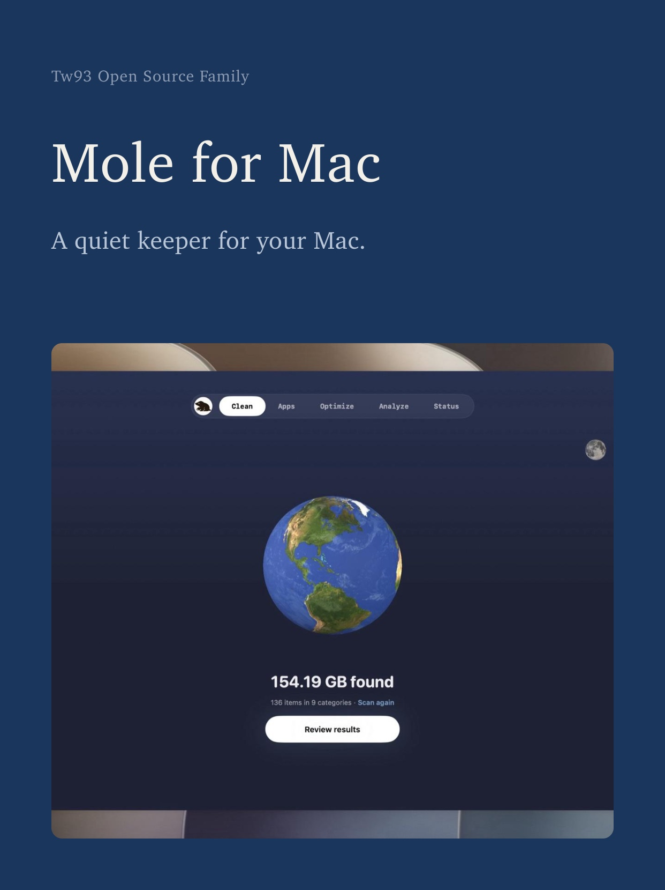
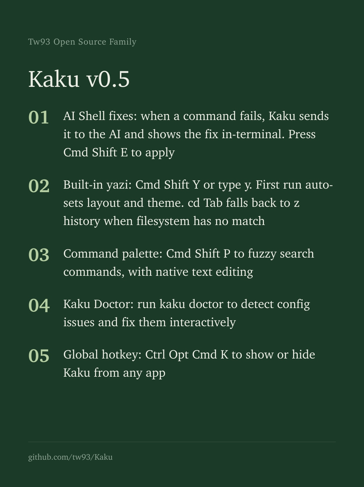
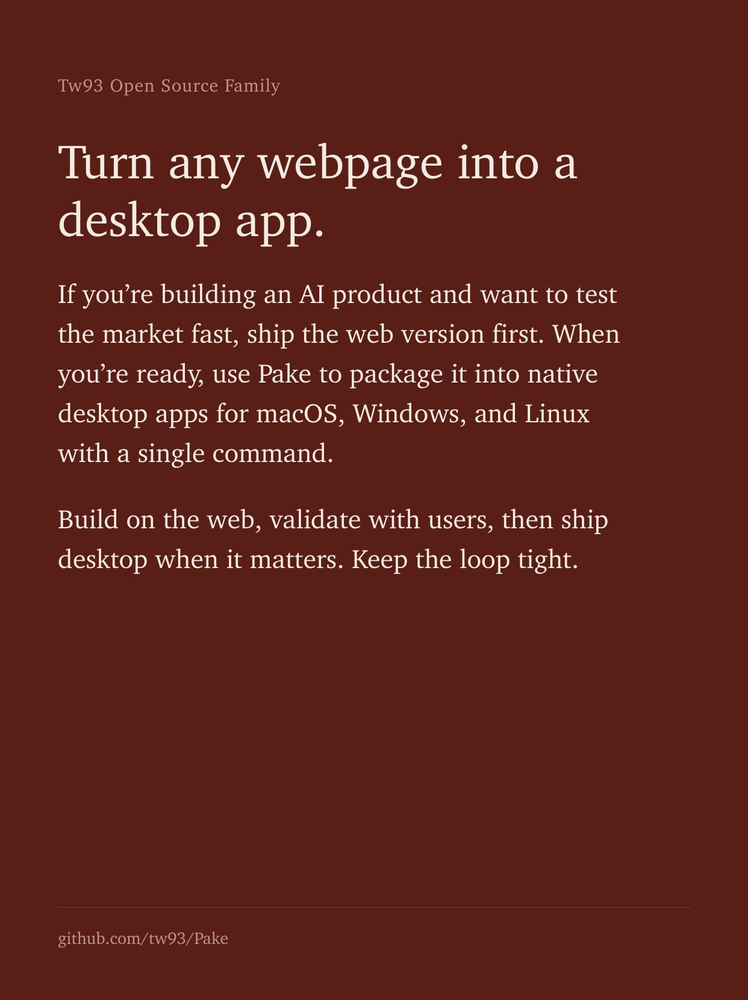
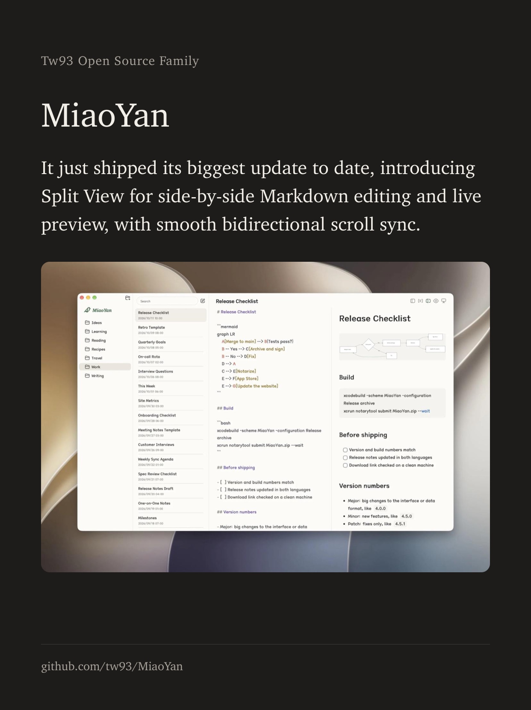

<div align="center">
  
  <h1>Kami</h1>
  <p><b>Good content deserves good paper.</b></p>
  <p>English · <a href="README_CN.md">中文</a> · <a href="README_TW.md">繁體</a> · <a href="README_JA.md">日本語</a> · <a href="README_KR.md">한국어</a> · <a href="README_DE.md">Deutsch</a> · <a href="README_FR.md">Français</a></p>
  <a href="https://github.com/tw93/kami/stargazers"></a>
  <a href="https://github.com/tw93/kami/releases"></a>
  <a href="LICENSE"></a>
  <a href="https://x.com/HiTw93"></a>
</div>

## Why

Kami (紙, かみ) means "paper" in Japanese. It gives AI agents layout rules and templates for PDF, PNG, and editable PowerPoint output, with nine built-in document templates and a product landing page.

As the delivery piece of the trilogy, Kami works alongside [Kaku](https://github.com/tw93/Kaku) (書く), built for writing code, and [Waza](https://github.com/tw93/Waza) (技), built around engineering habits, so technical work is not only logically rigorous but also visually compelling.

## Showcase

Sample PDFs in several formats and languages. Click any preview to open it.

<table>
<tr>
  <td align="center" width="25%">
    <a href="site/assets/demos/demo-musk-resume.pdf"></a>
    <br><b>Resume</b> · English
    <br><sub>Founder resume, 2 pages</sub>
  </td>
  <td align="center" width="25%">
    <a href="site/assets/demos/demo-kami-print.pdf"></a>
    <br><b>One-Pager</b> · 中文
    <br><sub>Kami 介绍 · 白底打印版</sub>
  </td>
  <td align="center" width="25%">
    <a href="site/assets/demos/demo-tesla.pdf"></a>
    <br><b>Equity Report</b> · 中文
    <br><sub>Tesla Q1 2026 财报点评</sub>
  </td>
  <td align="center" width="25%">
    <a href="site/assets/demos/demo-agent-slides.pdf"></a>
    <br><b>Slides</b> · English
    <br><sub>Agent keynote, 8 slides</sub>
  </td>
</tr>
<tr>
  <td align="center" width="25%">
    <a href="site/assets/demos/demo-mole.pdf"></a>
    <br><b>One-Pager</b> · English
    <br><sub>Mole product brief, 1 page</sub>
  </td>
  <td align="center" width="25%">
    <a href="site/assets/demos/demo-letter.pdf"></a>
    <br><b>Letter</b> · 中文
    <br><sub>推荐信, 1 页</sub>
  </td>
  <td align="center" width="25%">
    <a href="site/assets/demos/demo-changelog.pdf"></a>
    <br><b>Changelog</b> · English
    <br><sub>Mole v1.7.1 release notes</sub>
  </td>
  <td align="center" width="25%">
    <a href="site/assets/demos/demo-kaku.pdf"></a>
    <br><b>Portfolio</b> · 日本語
    <br><sub>Kaku ターミナル作品集 · 7 ページ</sub>
  </td>
</tr>
</table>

## Social Cards

The same paper, dyed a different color for Xiaohongshu and X. Eight papers, parchment, ink, olive, espresso, pine, teal, crimson and char, one per set. The four below come from my own products, with the text exactly as I posted it.

<table>
<tr>
  <td align="center" width="25%">
    <a href="site/assets/demos/demo-social-cards-mole-en.jpg"></a>
    <br><b>Mole</b>
    <br><sub>Cover, ink paper</sub>
  </td>
  <td align="center" width="25%">
    <a href="site/assets/demos/demo-social-cards-kaku-en.jpg"></a>
    <br><b>Kaku</b>
    <br><sub>List, pine paper</sub>
  </td>
  <td align="center" width="25%">
    <a href="site/assets/demos/demo-social-cards-pake-en.jpg"></a>
    <br><b>Pake</b>
    <br><sub>Text, crimson paper</sub>
  </td>
  <td align="center" width="25%">
    <a href="site/assets/demos/demo-social-cards-miaoyan-en.jpg"></a>
    <br><b>MiaoYan</b>
    <br><sub>Screenshot, char paper</sub>
  </td>
</tr>
</table>

## Install

**Claude Code, Codex, Cursor, and other agents**

```bash
npx skills add tw93/kami -a claude-code codex cursor -g -y
```

One copy lands in `~/.agents/skills`, the shared skills directory. Claude Code is symlinked in; Codex, Cursor, and every other agent that reads that directory picks Kami up as `/kami`. Update with `npx skills update -g -y`.

Or ask your agent:
> Install Kami for me by reading https://kami.tw93.fun/llms.txt

**Host plugin**, if you prefer the host's own update command (namespaced as `/kami:kami`, Claude Code v2.1.142 or newer):

```bash
# Claude Code (update: claude plugin update kami)
/plugin marketplace add tw93/kami
/plugin install kami@kami

# Codex (update: codex plugin marketplace upgrade kami, then codex plugin add kami@kami)
codex plugin marketplace add tw93/kami
codex plugin add kami@kami
```

**Claude Desktop**: download the release asset [kami.zip](https://github.com/tw93/kami/releases/latest/download/kami.zip), not GitHub's source ZIP, open Customize > Skills > "+" > Create skill, and upload it. To update, click "..." on the skill card, choose Replace, and upload the latest ZIP.

Large CJK fonts stay out of every package: `skills/kami/scripts/ensure-fonts.sh` recovers missing Chinese or Korean fonts into the user font directory, and in a repository checkout it copies the tracked fonts into the skill so templates load them locally before falling back to the jsDelivr CDN.

On Windows, run Kami inside WSL (Ubuntu): the helper scripts are Bash, and WeasyPrint on native Windows also needs the GTK/Pango runtime installed separately.

Kami also runs a quiet version check at most once a day and tells you in chat when a newer published release is out. It writes a marker in the local XDG cache directory, then resolves GitHub's latest public release; it uploads no user document or task content and fails silently when offline or when no cache home is available.

## Use

### Supported Languages

English and Chinese have the most complete support. Japanese and Korean use language-specific font fallbacks and layout adjustments, with each output checked before delivery. Each language uses a single serif font for the whole page, with font terms under [License](#license):

| Language | Support Level | Default Serif Font |
| :--- | :--- | :--- |
| **English** | Complete | Charter |
| **Chinese** (简体 / 繁體) | Complete | TsangerJinKai02 (仓耳今楷) |
| **Japanese** (日本語) | Font fallbacks & layout check | YuMincho (游明朝) |
| **Korean** (한국어) | Font fallbacks & layout check | Source Han Serif K (본명조) |

The skill auto-triggers from natural requests, no slash command needed. Example prompts by language:

- English: `make a one-pager for my startup` / `turn this research into a long doc` / `write a formal letter` / `make a portfolio of my projects` / `build me a resume` / `design a slide deck for my talk` / `make this talk as a Marp deck` / `build a landing page for my app`
- 中文: `帮我做一份一页纸` / `帮我排版一份长文档` / `帮我写一封正式信件` / `帮我做一份作品集` / `帮我做一份简历` / `帮我做一套演讲幻灯片` / `帮我做一份 Markdown 风格的演示稿` / `帮我做一个产品落地页`
- 日本語: `スタートアップ向けの一枚資料を作って` / `この調査を長文レポートに整えて` / `正式な依頼文を作って` / `プロジェクト作品集を作って` / `履歴書を作って` / `登壇用スライドを作って` / `Marp で登壇スライドを作って` / `アプリのランディングページを作って`
- 한국어: `스타트업 원페이저를 만들어줘` / `이 리서치를 장문 문서로 정리해줘` / `정식 레터를 작성해줘` / `프로젝트 포트폴리오를 만들어줘` / `이력서를 만들어줘` / `발표용 슬라이드를 만들어줘` / `Marp 슬라이드로 만들어줘` / `앱 랜딩 페이지를 만들어줘`

**Brand profile** (optional)

Create `~/.config/kami/brand.md` to persist identity, brand, defaults, and writing habits, so you don't repeat your preferences for each document. The file has YAML frontmatter for structured fields like name, role, email, brand color, language, page size, and tone, plus a Markdown body for freeform notes. Kami uses these settings where the current request leaves a choice open; explicit instructions always take priority. See [brand.example.md](skills/kami/references/brand.example.md) for a full template.

## Design

The defaults are a warm parchment background (`#f5f4ed`), ink-blue accents (`#1B365D`), and serif fonts. Templates use type size and spacing to separate titles, body text, and notes. You can adjust the defaults for your brand.

- **Templates.** Nine document templates: One-Pager, Long Doc, Letter, Portfolio, Resume, Slides, Equity Report, Changelog, and Social Cards, plus a Landing Page system, in EN, CN, and KO. Kami picks the right variant based on the language you write in.
- **Diagrams.** Eighteen inline SVG types, including a report-scale architecture board. Sequence, class, and ER can be authored from Mermaid text: [beautiful-mermaid](https://github.com/lukilabs/beautiful-mermaid) renders the SVG and `skills/kami/scripts/mermaid_normalize.py` re-themes it to the Kami palette and makes it WeasyPrint-safe, no Node bundled.
- **Slides.** Three rendering paths: WeasyPrint HTML to PDF by default, python-pptx for editable PPTX on request, and a Marp variant in `skills/kami/assets/templates/marp/` for Markdown-first decks.
- **Code.** Pygments-based syntax highlighting when `Pygments` is installed; without it, PDFs still render and code stays monochrome.
- **Verification.** Content schemas check structure before layout; coverage checks look for content missing from the filled page. A structured brief records the audience and requirements, and page images support the final visual review.
- **MCP.** A zero-dependency MCP server (`skills/kami/scripts/mcp_server.py`) exposes capability diagnosis, render, structured check, and screenshot tools, so any MCP-capable agent can drive Kami as an engine without loading the full skill prompt. Render only trusted local HTML: referenced file, HTTP, and HTTPS resources load with the MCP process's permissions.
- **Print.** Parchment is the default canvas; an opt-in white-paper variant flips any document to a white background for home or office printers, keeping warm backgrounds in cards and tables. The [one-page Kami intro](site/assets/demos/demo-kami-print.pdf) (Chinese) is rendered with this variant; recipe in [production.md](skills/kami/references/production.md).
- **Social cards.** Image cards for Xiaohongshu and X, one 1242x1660 page each, on eight papers that each carry a single accent, one paper per set. Delivery checks every card for text that outgrows it, runs onto the photo, or ends on a line of one or two characters. The author's words never change; line breaks are fixed with layout.

Full spec: [design.md](skills/kami/references/design.md). Cheatsheet: [CHEATSHEET.md](skills/kami/CHEATSHEET.md).

## Beyond Documents

<table>
<tr>
  <td align="center" width="25%" valign="top">
    <a href="https://kami.tw93.fun"></a>
    <br><b>Kami</b> · landing page
    <br><sub>Design system homepage</sub>
  </td>
  <td align="center" width="25%" valign="top">
    <a href="https://mole.fit"></a>
    <br><b>Mole</b> · landing page
    <br><sub>macOS system utility</sub>
  </td>
  <td align="center" width="25%" valign="top">
    
    <br><b>Architecture redraw</b> · English
    <br><sub>SpatialVLA Figure 1, schematic</sub>
  </td>
  <td align="center" width="25%" valign="top">
    
    <br><b>Evidence layout</b> · 中文
    <br><sub>Tesla Optimus 专利图一览</sub>
  </td>
</tr>
</table>

The same layout rules also work for landing pages and prompts for AI image tools. Landing pages ship as deployable multilingual sites. Illustrations use the host's own image generation when that capability is available; otherwise Kami outputs the same complete brief for use in an image model.

```text
Redraw this as a clean editorial diagram. Background: warm parchment (#f5f4ed), never pure white. One accent only, ink blue (#1B365D); everything else in warm gray with a yellow-brown undertone, no other colors. Thin single-line geometric strokes and simple flat icons. No gradients, no drop shadows, no 3D. Labels in a serif typeface. Generous whitespace, calm and composed, like a figure in a well-typeset report.
```

<sub>The two illustrations above were rendered by ChatGPT Images in a single pass, with no manual touch-up.</sub>

## Background

I like investing in US equities and ask Claude to write research reports all the time. Every output landed in the same default-doc look: gray, flat, a different layout each session. The structure was hard to scan, the formatting felt dated, and nothing about the page made me want to keep reading. So I started fixing the typography, the palette, the spacing, one rule at a time, until the report became a page I actually enjoyed.

Later I needed to present "The Agent You Don't Know: Principles, Architecture and Engineering Practice." I already had the document and didn't want to build slides from scratch, so I used Claude Design to lay it out in my own style, tweaked it round after round, and eventually got it to a place I was happy with. That process added inline SVG charts, a unified warm palette, and a tighter editorial rhythm. It kept growing until it covered every document I regularly ship, so I collected the templates and rules into Kami.

## Support

- The most direct way to support me is getting [Mole for Mac](https://mole.fit), my paid Mac cleanup app
- If Kami helped you, give it a star, [share it](https://x.com/intent/tweet?url=https://github.com/tw93/kami&text=Kami%20-%20A%20quiet%20design%20system%20for%20professional%20documents.), or open an issue or PR
- I have two cats, TangYuan and Coke, and if Kami has been useful, you can feed them <a href="https://cats.tw93.fun?name=Kami" target="_blank">canned food 🥩</a>

These lovely people already did 🐱

<a href="https://cats.tw93.fun?name=Kami"></a>

## License

MIT License for Kami code and templates. Please feel free to use and contribute to the development.

**Fonts**: TsangerJinKai02 is free for personal use only; commercial use requires a license from [tsanger.cn](https://tsanger.cn). Source Han Serif K and JetBrains Mono are under the OFL. Charter and YuMincho come from the operating system and are not shipped with Kami; CJK fallbacks are system-bundled or open-licensed.
