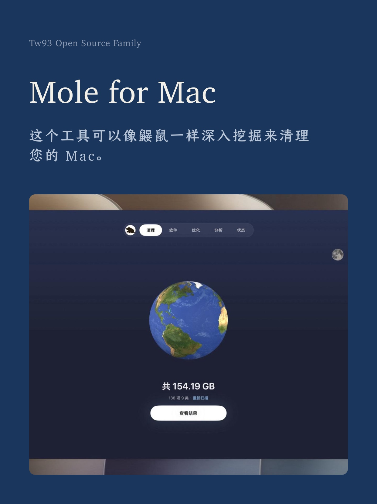
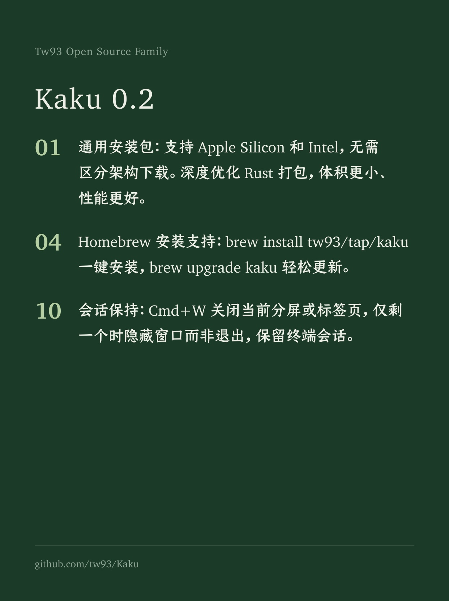
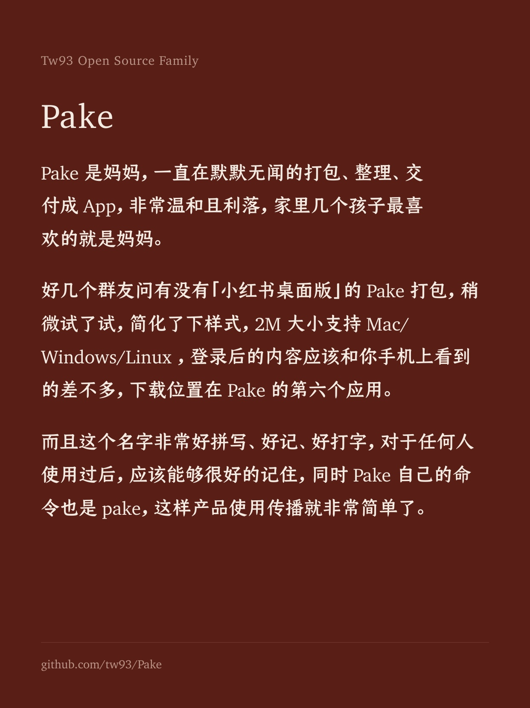
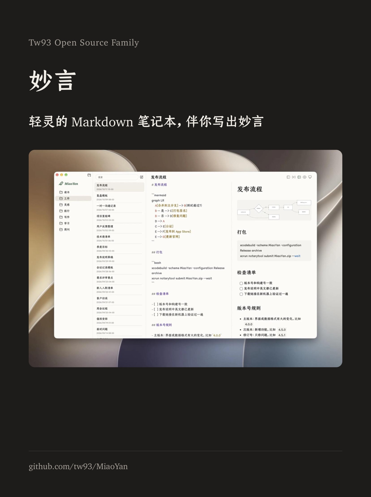
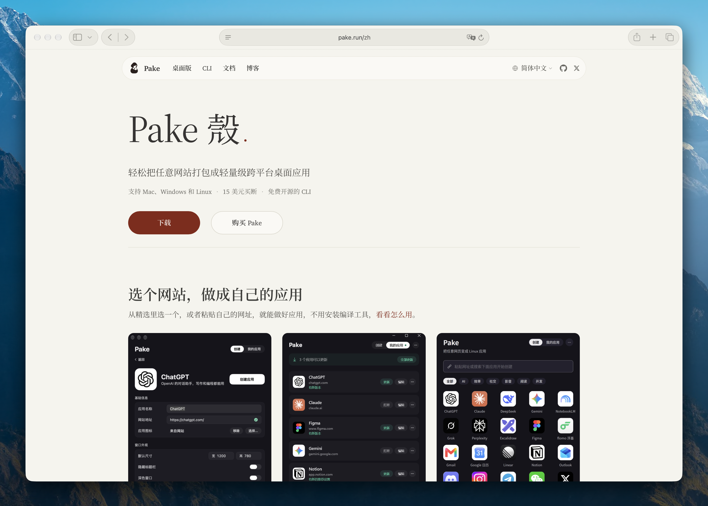
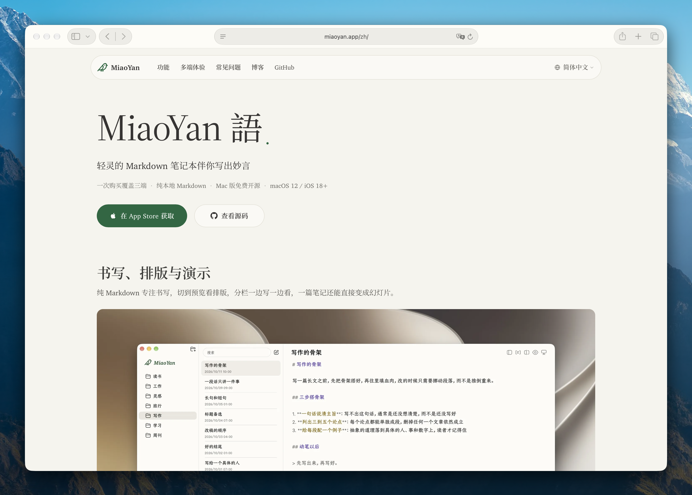
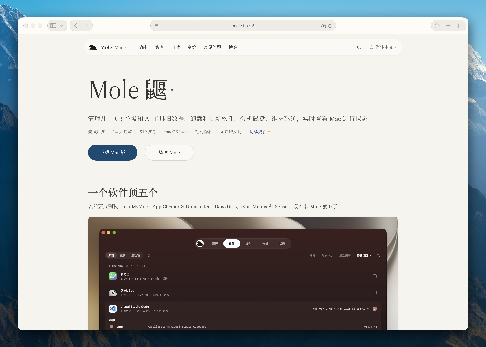

<div align="center">
  
  <h1>Kami</h1>
  <p><b>好内容，值得好版面</b></p>
  <p><a href="README.md">English</a> · 中文 · <a href="README_TW.md">繁體</a> · <a href="README_JA.md">日本語</a> · <a href="README_KR.md">한국어</a> · <a href="README_DE.md">Deutsch</a> · <a href="README_FR.md">Français</a></p>
  <a href="https://github.com/tw93/kami/stargazers"></a>
  <a href="https://github.com/tw93/kami/releases"></a>
  <a href="LICENSE"></a>
  <a href="https://x.com/HiTw93"></a>
</div>

## 简介

Kami（紙，かみ）在日文中意为“纸”，为 AI Agent 提供排版规则与模板，可输出 PDF、PNG 以及可编辑的 PowerPoint，内置 9 种文档模板和一套官网落地页。

作为三部曲中负责交付的一环，Kami 与专注写代码的 [Kaku](https://github.com/tw93/Kaku)（書く）、规范工程习惯的 [Waza](https://github.com/tw93/Waza)（技）相互配合，让技术成果既逻辑严谨，也排得好看。

## 样例展示

多种格式与语言的实际 PDF 输出样本，点击任意卡片即可查看完整文件。

<table>
<tr>
  <td align="center" width="25%">
    <a href="site/assets/demos/demo-musk-resume.pdf"></a>
    <br><b>简历</b> · 英文
    <br><sub>创始人简历，2 页</sub>
  </td>
  <td align="center" width="25%">
    <a href="site/assets/demos/demo-kami-print.pdf"></a>
    <br><b>一页纸</b> · 中文
    <br><sub>Kami 介绍，白底打印版，1 页</sub>
  </td>
  <td align="center" width="25%">
    <a href="site/assets/demos/demo-tesla.pdf"></a>
    <br><b>财报分析</b> · 中文
    <br><sub>Tesla Q1 2026 财报点评</sub>
  </td>
  <td align="center" width="25%">
    <a href="site/assets/demos/demo-agent-slides.pdf"></a>
    <br><b>幻灯片</b> · 英文
    <br><sub>Agent 演讲幻灯片，共 8 页</sub>
  </td>
</tr>
<tr>
  <td align="center" width="25%">
    <a href="site/assets/demos/demo-mole.pdf"></a>
    <br><b>一页纸</b> · 英文
    <br><sub>Mole 产品简介，1 页</sub>
  </td>
  <td align="center" width="25%">
    <a href="site/assets/demos/demo-letter.pdf"></a>
    <br><b>信件</b> · 中文
    <br><sub>正式推荐信，1 页</sub>
  </td>
  <td align="center" width="25%">
    <a href="site/assets/demos/demo-changelog.pdf"></a>
    <br><b>更新日志</b> · 英文
    <br><sub>Mole v1.7.1 发布说明</sub>
  </td>
  <td align="center" width="25%">
    <a href="site/assets/demos/demo-kaku.pdf"></a>
    <br><b>作品集</b> · 日文
    <br><sub>Kaku 终端作品集，7 页</sub>
  </td>
</tr>
</table>

## 社交图分享

小红书和 X 的配图，有八种底色可选，下面四张用的是我几个产品发过的原话，点开可以看大图。

<table>
<tr>
  <td align="center" width="25%">
    <a href="site/assets/demos/demo-social-cards-mole-zh.jpg"></a>
    <br><b>Mole</b>
    <br><sub>封面，墨蓝底</sub>
  </td>
  <td align="center" width="25%">
    <a href="site/assets/demos/demo-social-cards-kaku-zh.jpg"></a>
    <br><b>Kaku</b>
    <br><sub>列表，松绿底</sub>
  </td>
  <td align="center" width="25%">
    <a href="site/assets/demos/demo-social-cards-pake-zh.jpg"></a>
    <br><b>Pake</b>
    <br><sub>正文，砖红底</sub>
  </td>
  <td align="center" width="25%">
    <a href="site/assets/demos/demo-social-cards-miaoyan-zh.jpg"></a>
    <br><b>妙言</b>
    <br><sub>截图，炭黑底</sub>
  </td>
</tr>
</table>

## 安装

**Claude Code、Codex、Cursor 与其他 Agent**

```bash
npx skills add tw93/kami -a claude-code codex cursor -g -y
```

技能统一放在 `~/.agents/skills` 共享目录，Claude Code 通过软链接读取，Codex、Cursor 等读取这个目录的 Agent 都能用 `/kami` 调用，后续用 `npx skills update -g -y` 升级。

或者直接告诉 Agent 自动安装：
> 请阅读 https://kami.tw93.fun/llms.txt 为我安装 Kami

**宿主插件安装**（想用平台自带的升级命令时选这个，命名空间是 `/kami:kami`，需要 Claude Code v2.1.142 或更高版本）：

```bash
# Claude Code（升级命令：claude plugin update kami）
/plugin marketplace add tw93/kami
/plugin install kami@kami

# Codex（升级命令：codex plugin marketplace upgrade kami，然后 codex plugin add kami@kami）
codex plugin marketplace add tw93/kami
codex plugin add kami@kami
```

**Claude Desktop**：从 GitHub Releases 下载正式打包的 [kami.zip](https://github.com/tw93/kami/releases/latest/download/kami.zip)（不要下载仓库源代码 ZIP），打开 Customize > Skills > "+" > Create skill 上传。后续升级点击卡片上的 "..." 选择 Replace 替换为最新包。

大型中日韩字体不打进发布包，`skills/kami/scripts/ensure-fonts.sh` 会把缺失的中文或韩文字体补到用户字体目录（`~/.local/share/fonts/kami`），在本地仓库开发时，脚本还会把仓库里的字体复制进技能目录，模板优先读取本地字体，读不到时才回退到 jsDelivr CDN。

Windows 上推荐在 WSL（Ubuntu）里使用，辅助脚本都是 Bash，原生 Windows 跑 WeasyPrint 还要另装 GTK/Pango 运行库。

Kami 每天最多检查一次新版本，有新版就在对话里提一句，检查时会在本地 XDG 缓存目录写一个标记，再查 GitHub 最新的公开 Release，不上传任何文档和对话内容，离线或没有缓存目录时直接跳过。

## 使用

### 支持语言

英文和中文支持最完整，日文和韩文会按字体和排版逐份调整，交付前再检查一遍效果，每份文档全页只用一种衬线字体，字体授权见[授权条款](#授权条款)：

| 语言 | 支持程度 | 默认衬线字体 |
| :--- | :--- | :--- |
| **English** | 完整支持 | Charter |
| **中文**（简体 / 繁體） | 完整支持 | TsangerJinKai02（仓耳今楷） |
| **日本語** | 字体回退与逐份检查 | YuMincho（游明朝） |
| **한국어** | 字体回退与逐份检查 | Source Han Serif K（思源宋体韩文版） |

用日常自然语言吩咐 Agent 就会自动触发，不需要记斜杠命令，各语言提示词示例：

- 中文：`帮我做一份一页纸` / `帮我排版一份长文档` / `帮我写一封正式信件` / `帮我做一份作品集` / `帮我做一份简历` / `帮我做一套演讲幻灯片` / `帮我做一份 Markdown 风格的演示稿` / `帮我做一个产品落地页`
- English: `make a one-pager for my startup` / `turn this research into a long doc` / `write a formal letter` / `make a portfolio of my projects` / `build me a resume` / `design a slide deck for my talk` / `make this talk as a Marp deck` / `build a landing page for my app`
- 日本語: `スタートアップ向けの一枚資料を作って` / `この調査を長文レポートに整えて` / `正式な依頼文を作って` / `プロジェクト作品集を作って` / `履歴書を作って` / `登壇用スライドを作って` / `Marp で登壇スライドを作って` / `アプリのランディングページを作って`
- 한국어: `스타트업 원페이저를 만들어줘` / `이 리서치를 장문 문서로 정리해줘` / `정식 레터를 작성해줘` / `프로젝트 포트폴리오를 만들어줘` / `이력서를 만들어줘` / `발표용 슬라이드를 만들어줘` / `Marp 슬라이드로 만들어줘` / `앱 랜딩 페이지를 만들어줘`

**个人品牌偏好配置**（可选）

创建 `~/.config/kami/brand.md` 保存你的个人偏好、品牌主色、默认习惯与写作语气，配置好后不用每次对话都向 AI 叮嘱一遍。文件顶部为 YAML 格式字段（姓名、职位、邮箱、品牌色、语言、纸张尺寸、文风），正文为自由格式 Markdown。当前请求没有指定的地方 Kami 会用配置里的偏好，对话里的明确要求始终优先，完整示例见 [brand.example.md](skills/kami/references/brand.example.md)。

## 设计规范

默认采用温暖的浅米色底（`#f5f4ed`）、油墨蓝强调色（`#1B365D`）和衬线字体。模板依靠字号层级与留白节奏区分标题、正文与标注，这些默认值都可以按你的品牌调整。

- **模板体系**：9 种文档模板（一页纸、长文档、信件、作品集、简历、幻灯片、研报、更新日志、社交卡片）加一套落地页，都有中、英、韩三个版本，Kami 会按你写作的语言选对应版本
- **图表**：18 种行内原生 SVG 图表，包括单独成页的系统全景架构图，时序图、类图与实体关系图可直接写 Mermaid 源码，由 [beautiful-mermaid](https://github.com/lukilabs/beautiful-mermaid) 渲染为 SVG，再通过 `skills/kami/scripts/mermaid_normalize.py` 重着色为 Kami 配色并适配 WeasyPrint，无需本地安装 Node 环境
- **幻灯片**：默认用 WeasyPrint 把 HTML 转成 PDF，需要时通过 python-pptx 导出可二次编辑的 PPTX，Markdown 优先的演示稿用 `skills/kami/assets/templates/marp/` 下的 Marp 方案
- **代码高亮**：安装 Pygments 后自动支持语法着色，未安装时依然可正常生成纯黑灰代码块
- **检查**：JSON Schema 先行校验输入数据完整性，覆盖率检测防止关键内容在排版时遗漏，结构化简报记录受众和交付要求，交付前通过页面图片逐页校验节奏、孤行与排版平衡
- **本地 MCP 服务**：内置零外部依赖的 MCP 服务器（`skills/kami/scripts/mcp_server.py`），提供环境自检、渲染、结构化检查与截图工具，任何兼容 MCP 的 Agent 不用加载完整的技能提示词就能直接调用。只拿它渲染你信任的本地 HTML，页面引用的本地文件和 HTTP、HTTPS 资源会以 MCP 进程的权限加载
- **白底打印**：默认是浅米色底，也可以选用白底打印版，适合家里和办公室的打印机，卡片和表格仍保留暖色底。[Kami 介绍一页纸](site/assets/demos/demo-kami-print.pdf)就是用这个版本渲染的，完整配方见 [production.md](skills/kami/references/production.md)
- **社交卡片**：小红书和 X 的配图一张就是一页 1242x1660，八种底色各带一个强调色，一套图只用一种，交付时逐张检查有没有超出卡片、压到照片，或者末行只剩一两个字，作者的原话一字不改，断行靠调整排版解决

完整设计手册见 [design.md](skills/kami/references/design.md)，快速备忘单见 [CHEATSHEET.md](skills/kami/CHEATSHEET.md)。

## 不止于文档

<table>
<tr>
  <td align="center" width="33%" valign="top">
    <a href="https://pake.run"></a>
    <br><b>Pake</b> · 官网
    <br><sub>网页打包成桌面应用</sub>
  </td>
  <td align="center" width="33%" valign="top">
    <a href="https://miaoyan.app"></a>
    <br><b>妙言</b> · 官网
    <br><sub>轻灵的 Markdown 笔记本</sub>
  </td>
  <td align="center" width="33%" valign="top">
    <a href="https://mole.fit"></a>
    <br><b>Mole</b> · 官网
    <br><sub>Mac 清理和系统工具</sub>
  </td>
</tr>
</table>

<table>
<tr>
  <td align="center" width="50%" valign="top">
    
    <br><b>架构图重绘</b> · 英文
    <br><sub>SpatialVLA 论文图 1 重构</sub>
  </td>
  <td align="center" width="50%" valign="top">
    
    <br><b>专利图排版</b> · 中文
    <br><sub>Tesla Optimus 专利图一览</sub>
  </td>
</tr>
</table>

同一套排版规则也能用在落地页和 AI 绘图工具的提示词上，落地页可以直接部署成多语言网站，宿主自带图像生成能力时插图直接用它来画，没有这项能力时 Kami 会给出同样完整的要求，交给绘图模型使用：

```text
Redraw this as a clean editorial diagram. Background: warm parchment (#f5f4ed), never pure white. One accent only, ink blue (#1B365D); everything else in warm gray with a yellow-brown undertone, no other colors. Thin single-line geometric strokes and simple flat icons. No gradients, no drop shadows, no 3D. Labels in a serif typeface. Generous whitespace, calm and composed, like a figure in a well-typeset report.
```

<sub>表格里的两张插图由 ChatGPT Images 单次生成，无任何人工后期修图。</sub>

## 背景

我喜欢美股投资，经常让 Claude 写研究报告。每次出来的东西都是同一种默认文档的样子：灰扑扑的，结构不清晰，格式老旧，换个对话就换一套排版，没有一份让人想读下去。于是我开始一条一条地调字体、配色、间距，直到报告变成一份自己真正愿意看的页面。

后来要去做《你不知道的 Agent：原理、架构与工程实践》分享，手上已经有文档，不想再做 PPT，就用 Claude Design 按自己的设计风格来排版，反复调了很多轮，最后慢慢满意了。过程中加入 SVG 图表，统一配色和间距，逐渐用在常写的各种文档上，再把模板和规则整理成了现在的 Kami。

## 支持作者

- 购买我做的 Mac 清理工具 [Mole for Mac](https://mole.fit)，是对我最直接的支持
- 如果 Kami 帮到了你，欢迎给它一个 Star，[在 Twitter 分享](https://x.com/intent/tweet?url=https://github.com/tw93/kami&text=Kami%20-%20A%20quiet%20design%20system%20for%20professional%20documents.)，或提交 Issue 和 PR
- 我有两只猫，汤圆和可乐，如果 Kami 让你顺手，欢迎<a href="https://cats.tw93.fun?name=Kami" target="_blank">请她们吃罐头 🥩</a>

这些可爱的朋友已经请过啦 🐱

<a href="https://cats.tw93.fun?name=Kami"></a>

## 授权条款

MIT License for Kami code and templates. Please feel free to use and contribute to the development.

**字体许可**：仓耳今楷（TsangerJinKai02）个人非商用免费，商用授权请前往 [tsanger.cn](https://tsanger.cn)；思源宋体（Source Han Serif K）和 JetBrains Mono 采用 OFL 开源许可，Charter 和游明朝（YuMincho）来自操作系统，不随 Kami 分发，其余 CJK 回退字体为系统自带或开源授权。
