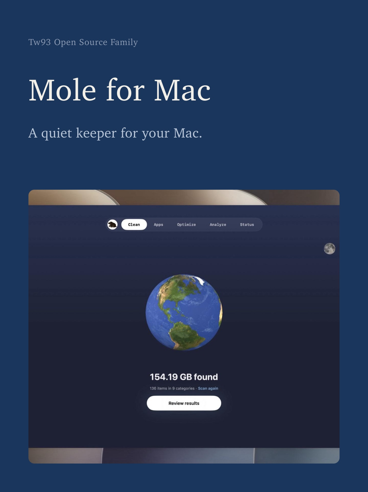
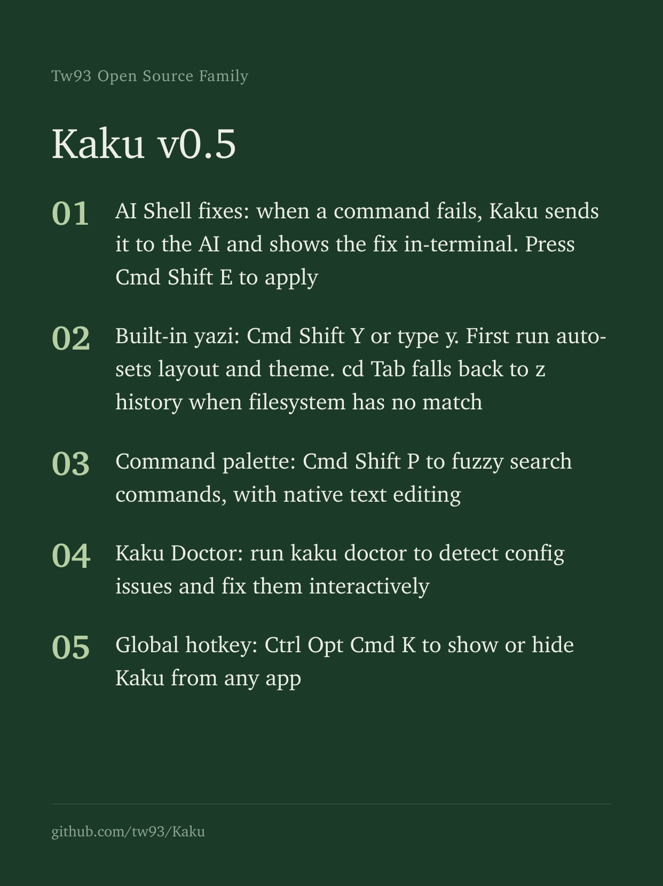
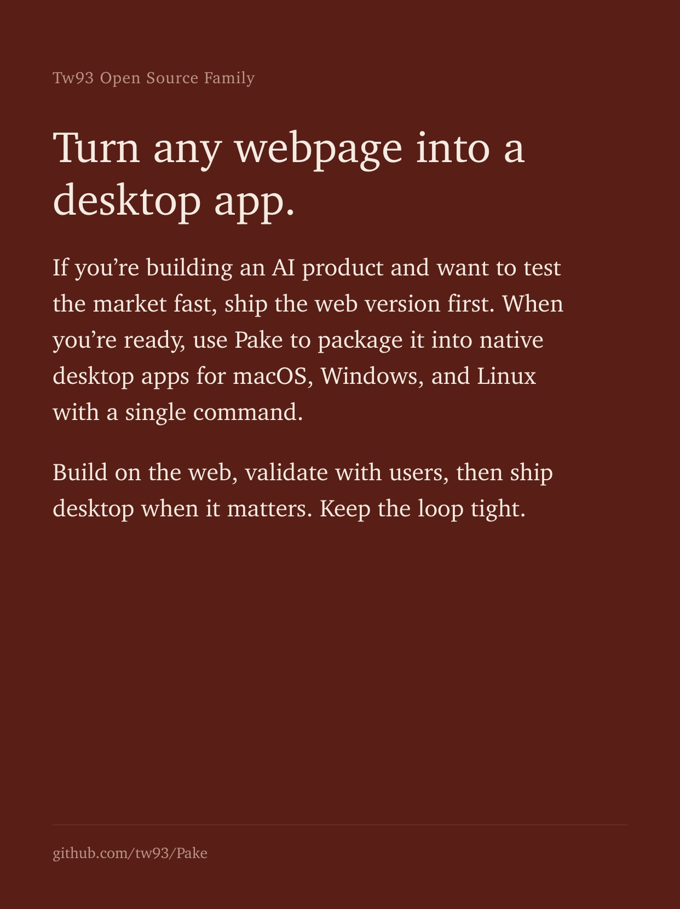
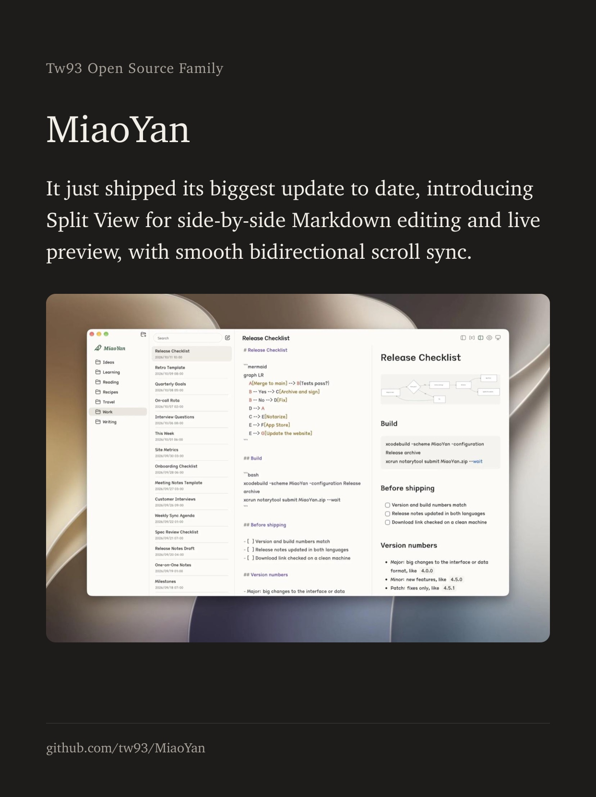

<div align="center">
  
  <h1>Kami</h1>
  <p><b>Un bon contenu mérite une belle typographie.</b></p>
  <p><a href="README.md">English</a> · <a href="README_CN.md">中文</a> · <a href="README_TW.md">繁體</a> · <a href="README_JA.md">日本語</a> · <a href="README_KR.md">한국어</a> · <a href="README_DE.md">Deutsch</a> · Français</p>
  <a href="https://github.com/tw93/kami/stargazers"></a>
  <a href="https://github.com/tw93/kami/releases"></a>
  <a href="LICENSE"></a>
  <a href="https://x.com/HiTw93"></a>
</div>

## Pourquoi Kami

Kami (紙, かみ) signifie « papier » en japonais. Il offre aux agents IA des règles de mise en page et des modèles pour générer des fichiers PDF, PNG et PowerPoint modifiables, avec neuf modèles de documents intégrés et une page d'accueil de produit.

En tant que dernière étape de livraison de la trilogie, Kami s'associe à [Kaku](https://github.com/tw93/Kaku) (書く) dédié au code et à [Waza](https://github.com/tw93/Waza) (技) dédié aux bonnes pratiques pour transformer les réalisations techniques en documents aussi rigoureux qu'élégants.

## Exemples

Exemples de PDF en plusieurs formats et langues. Cliquez sur un aperçu pour l'ouvrir.

<table>
<tr>
  <td align="center" width="25%">
    <a href="site/assets/demos/demo-musk-resume.pdf"></a>
    <br><b>CV</b> · Anglais
    <br><sub>CV de fondateur, 2 pages</sub>
  </td>
  <td align="center" width="25%">
    <a href="site/assets/demos/demo-kami-print.pdf"></a>
    <br><b>One-Pager</b> · Chinois
    <br><sub>Présentation Kami · Version imprimable</sub>
  </td>
  <td align="center" width="25%">
    <a href="site/assets/demos/demo-tesla.pdf"></a>
    <br><b>Rapport financier</b> · Chinois
    <br><sub>Analyse des résultats Tesla T1 2026</sub>
  </td>
  <td align="center" width="25%">
    <a href="site/assets/demos/demo-agent-slides.pdf"></a>
    <br><b>Diapositives</b> · Anglais
    <br><sub>Présentation sur les agents, 8 pages</sub>
  </td>
</tr>
<tr>
  <td align="center" width="25%">
    <a href="site/assets/demos/demo-mole.pdf"></a>
    <br><b>One-Pager</b> · Anglais
    <br><sub>Présentation de Mole, 1 page</sub>
  </td>
  <td align="center" width="25%">
    <a href="site/assets/demos/demo-letter.pdf"></a>
    <br><b>Lettre</b> · Chinois
    <br><sub>Lettre de recommandation, 1 page</sub>
  </td>
  <td align="center" width="25%">
    <a href="site/assets/demos/demo-changelog.pdf"></a>
    <br><b>Changelog</b> · Anglais
    <br><sub>Notes de version de Mole v1.7.1</sub>
  </td>
  <td align="center" width="25%">
    <a href="site/assets/demos/demo-kaku.pdf"></a>
    <br><b>Portfolio</b> · Japonais
    <br><sub>Portfolio du terminal Kaku, 7 pages</sub>
  </td>
</tr>
</table>

## Cartes pour les réseaux sociaux

Des cartes image pour Instagram et X, en huit couleurs de papier. Les quatre ci-dessous reprennent ce que j'ai publié sur mes propres produits. Cliquez sur une carte pour la voir en grand.

<table>
<tr>
  <td align="center" width="25%">
    <a href="site/assets/demos/demo-social-cards-mole-en.jpg"></a>
    <br><b>Mole</b>
    <br><sub>Couverture, ink</sub>
  </td>
  <td align="center" width="25%">
    <a href="site/assets/demos/demo-social-cards-kaku-en.jpg"></a>
    <br><b>Kaku</b>
    <br><sub>Liste, pine</sub>
  </td>
  <td align="center" width="25%">
    <a href="site/assets/demos/demo-social-cards-pake-en.jpg"></a>
    <br><b>Pake</b>
    <br><sub>Texte, crimson</sub>
  </td>
  <td align="center" width="25%">
    <a href="site/assets/demos/demo-social-cards-miaoyan-en.jpg"></a>
    <br><b>MiaoYan</b>
    <br><sub>Capture, char</sub>
  </td>
</tr>
</table>

## Installation

**Claude Code, Codex, Cursor et autres agents**

```bash
npx skills add tw93/kami -a claude-code codex cursor -g -y
```

Une copie est installée dans `~/.agents/skills`, le répertoire partagé des skills. Claude Code y est relié par lien symbolique ; Codex, Cursor et les autres agents accèdent à Kami via `/kami`. Mise à jour avec `npx skills update -g -y`.

Ou demandez directement à votre agent :
> Installe Kami en lisant https://kami.tw93.fun/llms.txt

**Plugin hôte**, si vous préférez la commande de mise à jour native (espace de noms `/kami:kami`, Claude Code v2.1.142 ou plus récent) :

```bash
# Claude Code (mise à jour : claude plugin update kami)
/plugin marketplace add tw93/kami
/plugin install kami@kami

# Codex (mise à jour : codex plugin marketplace upgrade kami, puis codex plugin add kami@kami)
codex plugin marketplace add tw93/kami
codex plugin add kami@kami
```

**Claude Desktop** : téléchargez l'archive officielle [kami.zip](https://github.com/tw93/kami/releases/latest/download/kami.zip) (et non le ZIP du code source GitHub), ouvrez Customize > Skills > « + » > Create skill et déposez l'archive. Pour mettre à jour, cliquez sur « ... » sur la carte du skill, choisissez Replace et déposez la dernière archive ZIP.

Les polices CJK volumineuses ne sont pas incluses dans le paquet : `skills/kami/scripts/ensure-fonts.sh` télécharge les polices chinoises ou coréennes manquantes dans le répertoire des polices de l'utilisateur ; dans un dépôt cloné, il copie les polices du dépôt dans le skill pour que les modèles les chargent localement avant de se rabattre sur le CDN jsDelivr.

Sous Windows, utilisez Kami dans WSL (Ubuntu) : les scripts d'aide sont en Bash, et WeasyPrint sous Windows natif nécessite en plus le runtime GTK/Pango.

Kami vérifie discrètement la disponibilité d'une nouvelle version au plus une fois par jour et vous prévient dans la conversation lorsqu'une version plus récente est publiée. Il écrit un marqueur dans le répertoire de cache XDG local puis interroge la dernière release publique sur GitHub ; aucune donnée personnelle ou contenu de document n'est envoyé, et en mode hors ligne ou sans accès au cache local, la vérification est ignorée en silence.

## Utilisation

### Langues prises en charge

L'anglais et le chinois bénéficient du support le plus complet. Le japonais et le coréen utilisent des polices de substitution dédiées et des ajustements de mise en page, chaque document étant vérifié avant livraison. Chaque langue utilise une seule police serif sur toute la page, le français comme l'anglais en Charter ; les conditions des polices figurent dans [Licence](#licence) :

| Langue | Niveau de prise en charge | Police serif par défaut |
| :--- | :--- | :--- |
| **Anglais** | Complet | Charter |
| **Chinois** (简体 / 繁體) | Complet | TsangerJinKai02 (仓耳今楷) |
| **Japonais** (日本語) | Polices de secours & vérification | YuMincho (游明朝) |
| **Coréen** (한국어) | Polices de secours & vérification | Source Han Serif K (본명조) |

Le skill se déclenche automatiquement à partir de requêtes formulées en langage naturel, sans commande spéciale. Exemples de requêtes :

- Anglais : `make a one-pager for my startup` / `turn this research into a long doc` / `write a formal letter` / `make a portfolio of my projects` / `build me a resume` / `design a slide deck for my talk` / `make this talk as a Marp deck` / `build a landing page for my app`
- Chinois : `帮我做一份一页纸` / `帮我排版一份长文档` / `帮我写一封正式信件` / `帮我做一份作品集` / `帮我做一份简历` / `帮我做一套演讲幻灯片` / `帮我做一份 Markdown 风格的演示稿` / `帮我做一个产品落地页`
- Japonais : `スタートアップ向けの一枚資料を作って` / `この調査を長文レポートに整えて` / `正式な依頼文を作って` / `プロジェクト作品集を作って` / `履歴書を作って` / `登壇用スライドを作って` / `Marp で登壇スライドを作って` / `アプリのランディングページを作って`
- Coréen : `스타트업 원페이저를 만들어줘` / `이 리서치를 장문 문서로 정리해줘` / `정식 레터를 작성해줘` / `프로젝트 포트폴리오를 만들어줘` / `이력서를 만들어줘` / `발표용 슬라이드를 만들어줘` / `Marp 슬라이드로 만들어줘` / `앱 랜딩 페이지를 만들어줘`
- Français : `Crée une fiche de synthèse pour mon projet` / `Mets en page cette recherche en document complet` / `Rédige une lettre officielle` / `Conçois un portfolio de mes projets` / `Crée un CV pour moi` / `Prépare des diapositives de présentation` / `Fais ces diapositives en Marp` / `Crée une landing page pour mon application`

**Profil de marque** (optionnel)

Créez `~/.config/kami/brand.md` pour conserver votre identité, vos couleurs et vos préférences d'écriture, sans avoir à les répéter pour chaque document. Le fichier contient un en-tête YAML pour les champs structurés (nom, fonction, e-mail, couleur de marque, langue, format de page, ton) et un corps Markdown pour les notes libres. Kami utilise ces réglages là où la requête en cours laisse un choix ouvert ; les instructions explicites priment toujours. Consultez [brand.example.md](skills/kami/references/brand.example.md) pour voir un modèle complet.

## Principes de conception

Les valeurs par défaut associent un fond parchemin chaleureux (`#f5f4ed`), des touches bleu encre (`#1B365D`) et des polices avec empattement (serif). La hiérarchie visuelle repose sur la taille des caractères et les espaces blancs. Vous pouvez adapter ces valeurs par défaut à votre marque.

- **Modèles.** Neuf modèles de documents : Fiche synthétique (One-Pager), Document long, Lettre, Portfolio, CV, Diapositives, Rapport d'analyse, Journal des modifications (Changelog) et Cartes pour réseaux sociaux, ainsi qu'un système de landing page, chacun en chinois, anglais et coréen. Kami choisit la variante adaptée à la langue dans laquelle vous écrivez.
- **Schémas.** 18 types de diagrammes vectoriels SVG intégrés, dont une planche d'architecture pleine page. Les diagrammes de séquence, de classes et entité-association peuvent être rédigés en syntaxe Mermaid : [beautiful-mermaid](https://github.com/lukilabs/beautiful-mermaid) génère le SVG et `skills/kami/scripts/mermaid_normalize.py` l'harmonise avec la palette de Kami et le rend compatible avec WeasyPrint, sans Node.
- **Diapositives.** Trois moteurs de rendu : WeasyPrint HTML vers PDF par défaut, python-pptx pour des fichiers PowerPoint modifiables sur demande, et une variante Marp dans `skills/kami/assets/templates/marp/` pour les présentations écrites en Markdown.
- **Code source.** Coloration syntaxique via Pygments si la bibliothèque est installée ; sinon, le code s'affiche en monochrome clair et lisible.
- **Validation.** Des schémas de contenu valident la structure avant mise en page ; un contrôle de couverture s'assure qu'aucun point clé n'a été oublié. Un brief structuré consigne le public et les exigences, et des images des pages servent à la relecture visuelle finale.
- **Serveur MCP.** Un serveur léger (`skills/kami/scripts/mcp_server.py`) expose des outils de diagnostic, de rendu, de vérification structurée et de capture d'écran, pour que tout agent compatible MCP pilote Kami sans charger le prompt complet du skill. Ne rendez que du HTML local de confiance : les fichiers et les ressources HTTP et HTTPS référencés sont chargés avec les droits du processus MCP.
- **Impression.** Le parchemin est le fond par défaut ; une variante papier blanc permet d'adapter n'importe quel document aux imprimantes domestiques et de bureau, tout en conservant les teintes douces des encadrés et des tableaux. La [présentation de Kami sur une page](site/assets/demos/demo-kami-print.pdf) (en chinois) est rendue avec cette variante, la recette se trouve dans [production.md](skills/kami/references/production.md).
- **Cartes pour les réseaux sociaux.** Des cartes image pour Instagram et X, une page de 1242x1660 chacune, sur huit papiers qui portent chacun une seule couleur d'accent, un papier par série. À la livraison, chaque carte est vérifiée : texte qui déborde, qui passe sur la photo ou qui finit sur une ligne d'un ou deux caractères. Le texte de l'auteur ne change jamais ; les retours à la ligne se règlent par la mise en page.

Spécifications complètes : [design.md](skills/kami/references/design.md). Aide-mémoire : [CHEATSHEET.md](skills/kami/CHEATSHEET.md).

## Au-delà du document

<table>
<tr>
  <td align="center" width="25%" valign="top">
    <a href="https://kami.tw93.fun"></a>
    <br><b>Kami</b> · landing page
    <br><sub>Site officiel du design system</sub>
  </td>
  <td align="center" width="25%" valign="top">
    <a href="https://mole.fit"></a>
    <br><b>Mole</b> · landing page
    <br><sub>Utilitaire système macOS</sub>
  </td>
  <td align="center" width="25%" valign="top">
    
    <br><b>Architecture</b> · Anglais
    <br><sub>Schéma redessiné SpatialVLA</sub>
  </td>
  <td align="center" width="25%" valign="top">
    
    <br><b>Schéma brevet</b> · Chinois
    <br><sub>Schéma du brevet Tesla Optimus</sub>
  </td>
</tr>
</table>

Les mêmes principes s'appliquent aux pages d'accueil de produits et aux prompts de génération d'images. Les landing pages sont livrées prêtes à déployer en versions multilingues. Les illustrations utilisent la génération d'images de l'hôte quand elle est disponible ; sinon, Kami fournit le même brief complet à utiliser dans un modèle d'image.

```text
Redraw this as a clean editorial diagram. Background: warm parchment (#f5f4ed), never pure white. One accent only, ink blue (#1B365D); everything else in warm gray with a yellow-brown undertone, no other colors. Thin single-line geometric strokes and simple flat icons. No gradients, no drop shadows, no 3D. Labels in a serif typeface. Generous whitespace, calm and composed, like a figure in a well-typeset report.
```

<sub>Les deux illustrations ci-dessus ont été générées par ChatGPT Images en une seule passe, sans retouche manuelle.</sub>

## Genèse

J'investis sur les marchés américains et je demande souvent à Claude de rédiger des synthèses d'analyse. Chaque document avait la même apparence terne par défaut : gris, uniforme, avec une structure différente à chaque session. Rien ne donnait envie de poursuivre la lecture. J'ai alors commencé à ajuster la typographie, les teintes et les espacements, règle après règle, jusqu'à obtenir des pages agréables à lire.

Plus tard, devant préparer une présentation sur les agents d'IA, je disposais déjà du contenu textuel sans vouloir reconstruire des diapositives de zéro. J'ai utilisé Claude Design pour concevoir la mise en page dans mon propre style. Cette démarche a vu naître les diagrammes SVG intégrés et une palette chaleureuse et cohérente. Ce système couvrant désormais l'ensemble de mes documents, j'ai réuni ces modèles et ces règles au sein de Kami.

## Soutien

- La façon la plus directe de me soutenir est d'acheter [Mole for Mac](https://mole.fit), mon application de nettoyage pour Mac
- Si Kami vous a été utile, vous pouvez lui attribuer une étoile sur GitHub, [le recommander](https://x.com/intent/tweet?url=https://github.com/tw93/kami&text=Kami%20-%20A%20quiet%20design%20system%20for%20professional%20documents.) ou contribuer via une issue ou une PR
- J'ai deux chats, TangYuan et Coke, et si Kami embellit vos journées, vous pouvez leur offrir <a href="https://cats.tw93.fun?name=Kami" target="_blank">une friandise 🥩</a>

Ceux qui ont déjà manifesté leur soutien 🐱

<a href="https://cats.tw93.fun?name=Kami"></a>

## Licence

MIT License for Kami code and templates. Please feel free to use and contribute to the development.

**Polices** : TsangerJinKai02 est gratuite pour un usage personnel uniquement ; un usage commercial requiert une licence auprès de [tsanger.cn](https://tsanger.cn). Source Han Serif K et JetBrains Mono sont sous licence OFL. Charter et YuMincho proviennent du système d'exploitation et ne sont pas distribuées avec Kami ; les polices de secours CJK sont intégrées au système ou sous licence libre.
