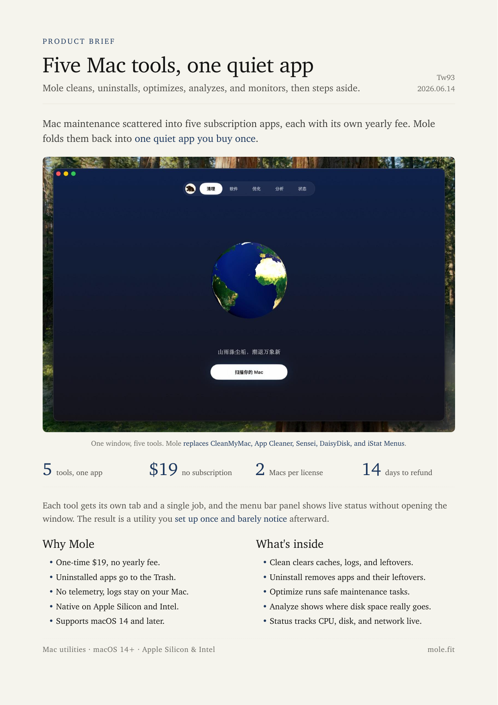

<div align="center">
  
  <h1>Kami</h1>
  <p><b>좋은 내용은 읽기 좋은 문서로</b></p>
  <p><a href="README.md">English</a> · <a href="README_CN.md">中文</a> · <a href="README_TW.md">繁體</a> · <a href="README_JA.md">日本語</a> · 한국어 · <a href="README_DE.md">Deutsch</a> · <a href="README_FR.md">Français</a></p>
  <a href="https://github.com/tw93/kami/stargazers"></a>
  <a href="https://github.com/tw93/kami/releases"></a>
  <a href="LICENSE"></a>
  <a href="https://x.com/HiTw93"></a>
</div>

## 소개

Kami(紙, 카미)는 일본어로 '종이'를 뜻합니다. AI Agent에게 조판 규칙과 템플릿을 제공하여 PDF, PNG 및 편집 가능한 PowerPoint를 출력하며, 8종의 문서 템플릿과 공식 웹사이트용 랜딩 페이지를 내장하고 있습니다.

3부작 중 최종 전달을 담당하는 마지막 단계로서, 코드를 작성하는 [Kaku](https://github.com/tw93/Kaku)(書く), 엔지니어링 습관을 다듬는 [Waza](https://github.com/tw93/Waza)(技)와 함께 기술적 결과물을 논리적이면서도 아름답게 완성합니다.

## 출력 샘플

다양한 형식과 언어로 렌더링된 실제 PDF 샘플입니다. 카드를 클릭하면 문서를 확인할 수 있습니다.

<table>
<tr>
  <td align="center" width="25%">
    <a href="site/assets/demos/demo-musk-resume.pdf"></a>
    <br><b>이력서</b> · 영어
    <br><sub>창업자 CV, 2페이지</sub>
  </td>
  <td align="center" width="25%">
    <a href="site/assets/demos/demo-kami-print.pdf"></a>
    <br><b>원페이저</b> · 중국어
    <br><sub>Kami 소개, 흰색 인쇄용, 1페이지</sub>
  </td>
  <td align="center" width="25%">
    <a href="site/assets/demos/demo-tesla.pdf"></a>
    <br><b>기업 분석</b> · 중국어
    <br><sub>Tesla Q1 2026 실적 보고서</sub>
  </td>
  <td align="center" width="25%">
    <a href="site/assets/demos/demo-agent-slides.pdf"></a>
    <br><b>슬라이드</b> · 영어
    <br><sub>발표용 슬라이드, 총 8페이지</sub>
  </td>
</tr>
<tr>
  <td align="center" width="25%">
    <a href="site/assets/demos/demo-mole.pdf"></a>
    <br><b>원페이저</b> · 영어
    <br><sub>Mole 제품 소개서, 1페이지</sub>
  </td>
  <td align="center" width="25%">
    <a href="site/assets/demos/demo-letter.pdf"></a>
    <br><b>서한</b> · 중국어
    <br><sub>공식 추천서, 1페이지</sub>
  </td>
  <td align="center" width="25%">
    <a href="site/assets/demos/demo-changelog.pdf"></a>
    <br><b>릴리스 노트</b> · 영어
    <br><sub>Mole v1.7.1 릴리스 노트</sub>
  </td>
  <td align="center" width="25%">
    <a href="site/assets/demos/demo-kaku.pdf"></a>
    <br><b>포트폴리오</b> · 일본어
    <br><sub>Kaku 터미널 작품집, 7페이지</sub>
  </td>
</tr>
</table>

## 설치

**Claude Code, Codex, Cursor 및 기타 에이전트**

```bash
npx skills add tw93/kami -a claude-code codex cursor -g -y
```

스킬은 공용 디렉터리인 `~/.agents/skills`에 설치됩니다. Claude Code에는 심볼릭 링크가 생성되며, Codex와 Cursor 등 규격을 지원하는 에이전트는 `/kami`로 인식합니다. 업데이트는 `npx skills update -g -y`로 진행할 수 있습니다.

또는 에이전트에게 직접 설치를 요청하세요:
> https://kami.tw93.fun/llms.txt 를 읽고 Kami를 설치해 줘

**호스트 플러그인 설치** (호스트 자체 업데이트 명령을 선호할 경우, 네임스페이스는 `/kami:kami`, Claude Code v2.1.142 이상):

```bash
# Claude Code (업데이트: claude plugin update kami)
/plugin marketplace add tw93/kami
/plugin install kami@kami

# Codex (업데이트: codex plugin marketplace upgrade kami 후 codex plugin add kami@kami)
codex plugin marketplace add tw93/kami
codex plugin add kami@kami
```

**Claude Desktop**: GitHub Releases에서 정식 릴리스된 [kami.zip](https://github.com/tw93/kami/releases/latest/download/kami.zip)을 다운로드한 후, Customize > Skills > "+" > Create skill에서 업로드하세요. GitHub 소스 ZIP이 아니라 이 릴리스 에셋을 사용해야 합니다. 업데이트할 때는 스킬 카드의 "..."에서 Replace를 선택하고 최신 ZIP을 업로드하세요.

용량이 큰 CJK 글꼴은 릴리스 패키지에 포함되지 않습니다. `skills/kami/scripts/ensure-fonts.sh`가 없는 중국어나 한국어 글꼴을 사용자 폰트 디렉터리에 설치하고, 저장소를 체크아웃한 경우에는 저장소에 포함된 글꼴을 스킬에 복사해 템플릿이 먼저 로컬 글꼴을 읽고 없을 때만 jsDelivr CDN을 사용합니다.

Windows에서는 WSL(Ubuntu)에서 사용하는 것을 권장합니다. 보조 스크립트가 Bash로 작성되어 있고, 네이티브 Windows에서 WeasyPrint를 실행하려면 GTK/Pango 런타임을 따로 설치해야 합니다.

Kami는 하루에 최대 한 번 조용히 버전을 확인하고, 새 릴리스가 있으면 대화에서 알려 줍니다. 로컬 XDG 캐시 디렉터리에 마커를 기록한 뒤 GitHub의 최신 공개 릴리스를 확인하며, 문서나 대화 내용은 전송하지 않습니다. 오프라인이거나 캐시 디렉터리를 쓸 수 없으면 조용히 건너뜁니다.

## 사용법

### 지원 언어

영어와 중국어를 가장 완전하게 지원합니다. 일본어와 한국어는 전용 폰트 대체와 레이아웃 조정을 통해 지원되며, 결과물을 확인한 후 제공됩니다. 모든 문서는 페이지 전체에 하나의 세리프 글꼴만 사용하며, 글꼴 라이선스는 [라이선스](#라이선스)를 참조하세요:

| 언어 | 지원 수준 | 기본 명조/세리프 글꼴 |
| :--- | :--- | :--- |
| **English** | 완전 지원 | Charter |
| **중국어** (간체 / 번체) | 완전 지원 | TsangerJinKai02 (창이진카이) |
| **일본어** (日本語) | 폰트 대체 및 레이아웃 검증 | YuMincho (유민초) |
| **한국어** | 폰트 대체 및 레이아웃 검증 | Source Han Serif K (본명조) |

슬래시 명령어를 외울 필요 없이, 일상적인 자연어로 에이전트에게 요청하면 자동으로 실행됩니다. 언어별 프롬프트 예시:

- 한국어: `스타트업 원페이저를 만들어줘` / `이 리서치를 장문 문서로 정리해줘` / `정식 레터를 작성해줘` / `프로젝트 포트폴리오를 만들어줘` / `이력서를 만들어줘` / `발표용 슬라이드를 만들어줘` / `Marp 슬라이드로 만들어줘` / `앱 랜딩 페이지를 만들어줘`
- English: `make a one-pager for my startup` / `turn this research into a long doc` / `write a formal letter` / `make a portfolio of my projects` / `build me a resume` / `design a slide deck for my talk` / `make this talk as a Marp deck` / `build a landing page for my app`
- 中文: `帮我做一份一页纸` / `帮我排版一份长文档` / `帮我写一封正式信件` / `帮我做一份作品集` / `帮我做一份简历` / `帮我做一套演讲幻灯片` / `帮我做一份 Markdown 风格的演示稿` / `帮我做一个产品落地页`
- 日本語: `スタートアップ向けの一枚資料を作って` / `この調査を長文レポートに整えて` / `正式な依頼文を作って` / `プロジェクト作品集を作って` / `履歴書を作って` / `登壇用スライドを作って` / `Marp で登壇スライドを作って` / `アプリのランディングページを作って`

**브랜드 프로필 설정** (선택)

`~/.config/kami/brand.md`를 만들어 정체성, 브랜드, 기본값, 글쓰기 습관을 저장해 두면 문서마다 선호를 반복해서 말할 필요가 없습니다. 파일 상단의 YAML 프론트매터에는 이름, 직함, 이메일, 브랜드 색상, 언어, 용지 크기, 톤 같은 구조화된 필드를, 본문 Markdown에는 자유 메모를 적습니다. Kami는 현재 요청에서 정하지 않은 부분에 이 설정을 사용하며, 명시적인 지시가 항상 우선합니다. 전체 템플릿은 [brand.example.md](skills/kami/references/brand.example.md)를 확인하세요.

## 디자인 원칙

기본 스타일은 따뜻한 양피지 배경색(`#f5f4ed`), 잉크 블루(`#1B365D`) 강조색, 그리고 세리프 글꼴입니다. 글꼴 크기와 여백의 리듬으로 제목, 본문, 주석을 구분합니다. 브랜드에 맞게 기본값을 조정할 수 있습니다.

- **템플릿 모음**: 원페이저, 장문 보고서, 서한, 포트폴리오, 이력서, 슬라이드, 기업 분석 보고서, 릴리스 노트 등 8종과 랜딩 페이지 시스템. 모두 중국어, 영어, 한국어 버전이 있으며, 작성하는 언어에 맞춰 Kami가 해당 버전을 고릅니다.
- **다이어그램**: 18종의 인라인 SVG 다이어그램으로, 한 페이지를 쓰는 아키텍처 보드도 포함합니다. 시퀀스, 클래스, ER 다이어그램은 Mermaid 텍스트로 작성할 수 있으며, [beautiful-mermaid](https://github.com/lukilabs/beautiful-mermaid)가 SVG를 렌더링하고 `skills/kami/scripts/mermaid_normalize.py`가 Kami 팔레트로 바꿔 WeasyPrint에 맞춥니다. Node는 번들하지 않습니다.
- **슬라이드**: 기본은 WeasyPrint로 HTML을 PDF로 변환하고, 요청하면 python-pptx로 편집 가능한 PPTX를, Markdown 우선 덱에는 `skills/kami/assets/templates/marp/`의 Marp 템플릿을 사용합니다.
- **코드 하이라이팅**: Pygments가 설치되어 있으면 구문 강조를 지원하고, 없어도 PDF는 렌더링되며 코드는 단색으로 표시됩니다.
- **품질 검증**: JSON Schema 입력 검증과 내용 누락을 방지하는 커버리지 검증을 실행하고, 구조화된 브리프가 독자와 요구 사항을 기록하며, 페이지 이미지로 최종 시각적 검수를 합니다.
- **로컬 MCP 서버**: 의존성 없는 MCP 서버(`skills/kami/scripts/mcp_server.py`)가 내장되어 있어 환경 진단, 렌더링, 구조 검사, 스크린샷 도구를 제공하므로, MCP를 지원하는 에이전트는 전체 스킬 프롬프트를 불러오지 않고도 바로 호출할 수 있습니다. 신뢰할 수 있는 로컬 HTML만 렌더링하세요. 참조된 파일과 HTTP, HTTPS 리소스는 MCP 프로세스의 권한으로 로드됩니다.
- **인쇄용 흰색 모드**: 기본 양피지 배경 외에 가정이나 사무실 프린터에 맞는 흰색 배경으로 전환할 수 있으며, 카드와 표에는 따뜻한 배경이 남습니다. [Kami 소개 원페이저](site/assets/demos/demo-kami-print.pdf)(중국어)가 이 모드로 렌더링되었고, 방법은 [production.md](skills/kami/references/production.md)에 있습니다.

전체 사양: [design.md](skills/kami/references/design.md), 빠른 참조: [CHEATSHEET.md](skills/kami/CHEATSHEET.md).

## 문서를 넘어서

<table>
<tr>
  <td align="center" width="25%" valign="top">
    <a href="https://kami.tw93.fun"></a>
    <br><b>Kami</b> · 랜딩 페이지
    <br><sub>디자인 시스템 공식 사이트</sub>
  </td>
  <td align="center" width="25%" valign="top">
    <a href="https://mole.fit"></a>
    <br><b>Mole</b> · 랜딩 페이지
    <br><sub>macOS 시스템 클리너</sub>
  </td>
  <td align="center" width="25%" valign="top">
    
    <br><b>구조도 재구성</b> · 영어
    <br><sub>SpatialVLA 논문 다이어그램 1</sub>
  </td>
  <td align="center" width="25%" valign="top">
    
    <br><b>특허도 배치</b> · 중국어
    <br><sub>Tesla Optimus 특허 도면 일람</sub>
  </td>
</tr>
</table>

같은 조판 규칙은 제품 웹사이트 제작 및 이미지 생성 AI 프롬프트 지침에도 그대로 적용됩니다. 랜딩 페이지는 다국어 사이트로 바로 배포할 수 있습니다. 호스트에 이미지 생성 기능이 있으면 그 기능으로 삽화를 그리고, 없으면 Kami가 같은 내용의 완전한 브리프를 출력해 이미지 모델에서 쓸 수 있게 합니다.

```text
Redraw this as a clean editorial diagram. Background: warm parchment (#f5f4ed), never pure white. One accent only, ink blue (#1B365D); everything else in warm gray with a yellow-brown undertone, no other colors. Thin single-line geometric strokes and simple flat icons. No gradients, no drop shadows, no 3D. Labels in a serif typeface. Generous whitespace, calm and composed, like a figure in a well-typeset report.
```

<sub>표의 두 삽화는 ChatGPT Images로 한 번에 생성했으며 수작업 보정은 하지 않았습니다.</sub>

## 배경

저는 미국 주식에 투자하며 항상 Claude에게 리서치 리포트를 작성해 달라고 합니다. 매번 출력물은 같은 기본 문서 모양이었습니다: 회색이고, 평면적이며, 세션마다 레이아웃이 달랐습니다. 구조를 파악하기 어렵고, 서식은 구식이었으며, 페이지의 어떤 것도 계속 읽고 싶게 만들지 못했습니다. 그래서 타이포그래피, 팔레트, 간격을 하나의 규칙씩 고쳐나가기 시작했고, 결국 리포트는 제가 실제로 즐길 수 있는 페이지가 되었습니다.

나중에 "당신이 모르는 에이전트: 원칙, 아키텍처, 엔지니어링 실무"를 발표해야 했습니다. 이미 문서가 있었고 슬라이드를 처음부터 만들고 싶지 않아서, Claude Design으로 제 스타일에 맞게 레이아웃을 잡고 여러 차례 수정하여 만족스러운 수준에 도달했습니다. 그 과정에서 인라인 SVG 차트를 넣고 색상과 간격을 정리했습니다. 평소 만드는 문서에도 적용하면서 템플릿과 규칙을 모았고, 그렇게 Kami가 되었습니다.

## 후원하기

- 유료 Mac 정리 앱 [Mole for Mac](https://mole.fit)을 구매해 주시는 것이 가장 직접적인 후원입니다
- Kami가 유용했다면 Star를 주시거나, [Twitter에 공유](https://x.com/intent/tweet?url=https://github.com/tw93/kami&text=Kami%20-%20A%20quiet%20design%20system%20for%20professional%20documents.)하거나, Issue와 PR을 남겨주세요
- 저에게는 탕위안(TangYuan)과 콜라(Coke)라는 두 마리의 고양이가 있는데, Kami가 도움이 되었다면 <a href="https://cats.tw93.fun?name=Kami" target="_blank">캔을 선물해 주세요 🥩</a>

후원해 주신 분들 🐱

<a href="https://cats.tw93.fun?name=Kami"></a>

## 라이선스

MIT License for Kami code and templates. Please feel free to use and contribute to the development.

**글꼴 라이선스**: TsangerJinKai02는 개인 비상업적 무료이며 상업적 이용은 [tsanger.cn](https://tsanger.cn) 라이선스가 필요합니다. Source Han Serif K와 JetBrains Mono는 OFL이며, Charter와 YuMincho는 운영체제에 포함된 글꼴로 Kami와 함께 배포되지 않습니다. CJK 대체 글꼴은 시스템 번들 또는 오픈소스입니다.
