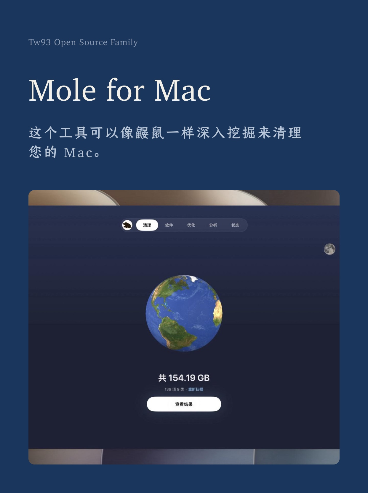
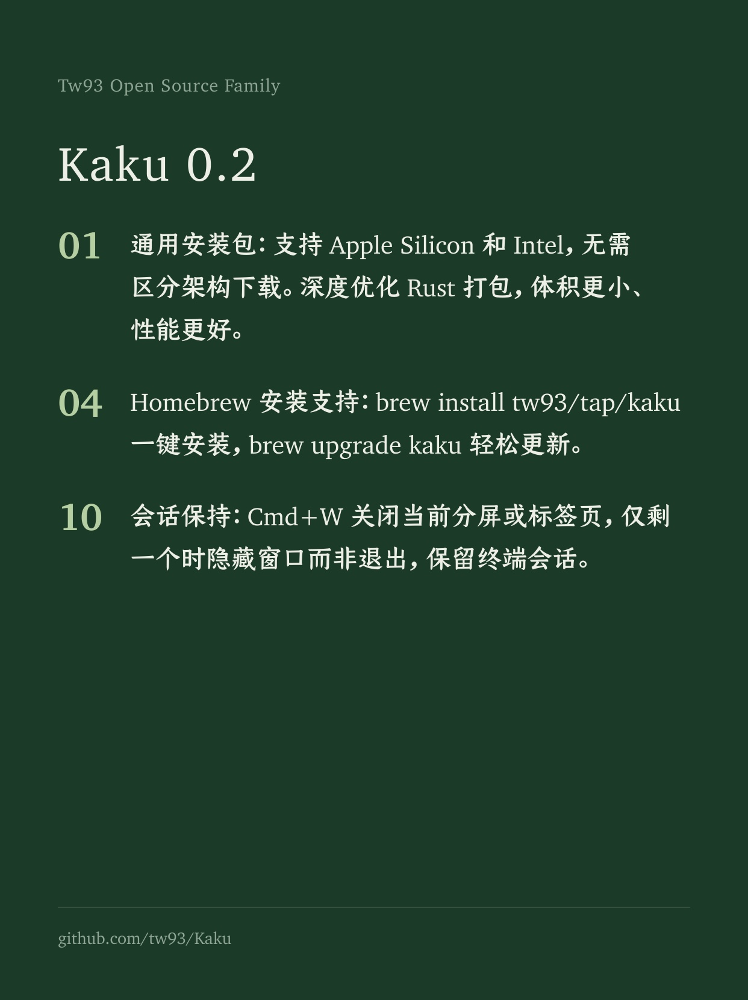
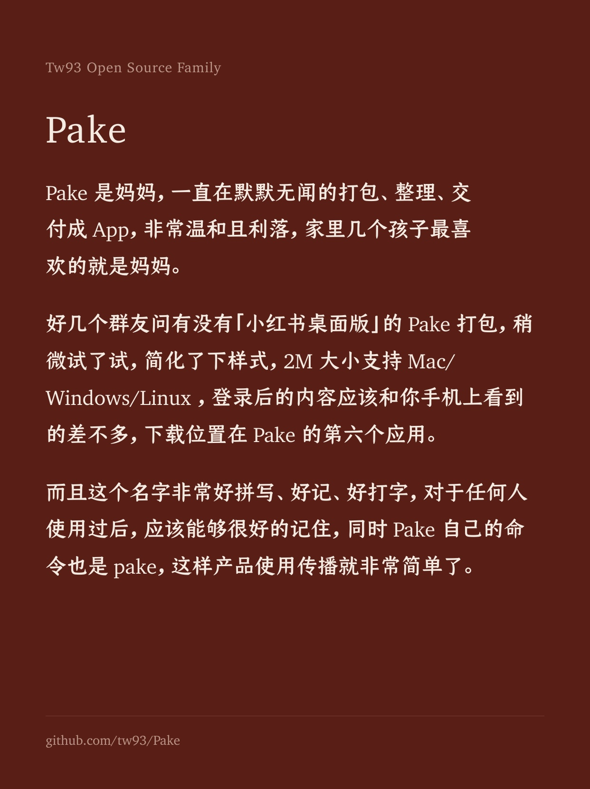
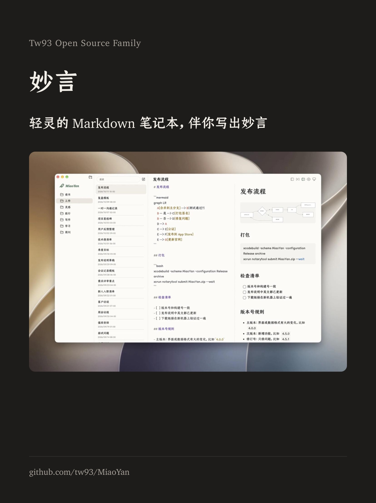

<div align="center">
  
  <h1>Kami</h1>
  <p><b>好內容，值得好版面</b></p>
  <p><a href="README.md">English</a> · <a href="README_CN.md">中文</a> · 繁體 · <a href="README_JA.md">日本語</a> · <a href="README_KR.md">한국어</a> · <a href="README_DE.md">Deutsch</a> · <a href="README_FR.md">Français</a></p>
  <a href="https://github.com/tw93/kami/stargazers"></a>
  <a href="https://github.com/tw93/kami/releases"></a>
  <a href="LICENSE"></a>
  <a href="https://x.com/HiTw93"></a>
</div>

## 簡介

Kami（紙，かみ）在日文中意為「紙」，為 AI Agent 提供排版規則與範本，可輸出 PDF、PNG 以及可編輯的 PowerPoint，內建 9 種文件範本和一套官網落地頁。

作為三部曲中負責交付的一環，Kami 與專注寫程式碼的 [Kaku](https://github.com/tw93/Kaku)（書く）、規範工程習慣的 [Waza](https://github.com/tw93/Waza)（技）相互配合，讓技術成果既邏輯嚴謹，也排得好看。

## 範例展示

多種格式與語言的實際 PDF 輸出樣本，點選任意卡片即可檢視完整文件。

<table>
<tr>
  <td align="center" width="25%">
    <a href="site/assets/demos/demo-musk-resume.pdf"></a>
    <br><b>履歷</b> · 英文
    <br><sub>創辦人履歷，2 頁</sub>
  </td>
  <td align="center" width="25%">
    <a href="site/assets/demos/demo-kami-print.pdf"></a>
    <br><b>一頁紙</b> · 中文
    <br><sub>Kami 介紹，白底列印版，1 頁</sub>
  </td>
  <td align="center" width="25%">
    <a href="site/assets/demos/demo-tesla.pdf"></a>
    <br><b>財報分析</b> · 中文
    <br><sub>Tesla Q1 2026 財報點評</sub>
  </td>
  <td align="center" width="25%">
    <a href="site/assets/demos/demo-agent-slides.pdf"></a>
    <br><b>簡報</b> · 英文
    <br><sub>Agent 演講簡報，共 8 頁</sub>
  </td>
</tr>
<tr>
  <td align="center" width="25%">
    <a href="site/assets/demos/demo-mole.pdf"></a>
    <br><b>一頁紙</b> · 英文
    <br><sub>Mole 產品簡介，1 頁</sub>
  </td>
  <td align="center" width="25%">
    <a href="site/assets/demos/demo-letter.pdf"></a>
    <br><b>信件</b> · 中文
    <br><sub>正式推薦信，1 頁</sub>
  </td>
  <td align="center" width="25%">
    <a href="site/assets/demos/demo-changelog.pdf"></a>
    <br><b>更新日誌</b> · 英文
    <br><sub>Mole v1.7.1 發布說明</sub>
  </td>
  <td align="center" width="25%">
    <a href="site/assets/demos/demo-kaku.pdf"></a>
    <br><b>作品集</b> · 日文
    <br><sub>Kaku 終端機作品集，7 頁</sub>
  </td>
</tr>
</table>

## 社群分享圖

Instagram 和 Threads 的配圖，有八種底色可選，下面四張用的是我幾個產品發過的原話，點開可以看大圖。

<table>
<tr>
  <td align="center" width="25%">
    <a href="site/assets/demos/demo-social-cards-mole-zh.jpg"></a>
    <br><b>Mole</b>
    <br><sub>封面，墨藍底</sub>
  </td>
  <td align="center" width="25%">
    <a href="site/assets/demos/demo-social-cards-kaku-zh.jpg"></a>
    <br><b>Kaku</b>
    <br><sub>列表，松綠底</sub>
  </td>
  <td align="center" width="25%">
    <a href="site/assets/demos/demo-social-cards-pake-zh.jpg"></a>
    <br><b>Pake</b>
    <br><sub>正文，磚紅底</sub>
  </td>
  <td align="center" width="25%">
    <a href="site/assets/demos/demo-social-cards-miaoyan-zh.jpg"></a>
    <br><b>妙言</b>
    <br><sub>截圖，炭黑底</sub>
  </td>
</tr>
</table>

## 安裝

**Claude Code、Codex、Cursor 與其他 Agent**

```bash
npx skills add tw93/kami -a claude-code codex cursor -g -y
```

技能統一放在 `~/.agents/skills` 共享目錄，Claude Code 透過符號連結讀取，Codex、Cursor 等讀取這個目錄的 Agent 都能用 `/kami` 呼叫，後續用 `npx skills update -g -y` 更新。

或者直接告訴 Agent 自動安裝：
> 請閱讀 https://kami.tw93.fun/llms.txt 為我安裝 Kami

**宿主外掛安裝**（想用平台內建的升級指令時選這個，命名空間是 `/kami:kami`，需要 Claude Code v2.1.142 或更高版本）：

```bash
# Claude Code（升級指令：claude plugin update kami）
/plugin marketplace add tw93/kami
/plugin install kami@kami

# Codex（升級指令：codex plugin marketplace upgrade kami，然後 codex plugin add kami@kami）
codex plugin marketplace add tw93/kami
codex plugin add kami@kami
```

**Claude Desktop**：從 GitHub Releases 下載正式打包的 [kami.zip](https://github.com/tw93/kami/releases/latest/download/kami.zip)（不要下載原始碼 ZIP），開啟 Customize > Skills > "+" > Create skill 上傳。後續升級點擊卡片上的 "..." 選擇 Replace 替換為最新包。

大型中日韓字型不打進發行包，`skills/kami/scripts/ensure-fonts.sh` 會把缺少的中文或韓文字型補到使用者字型目錄（`~/.local/share/fonts/kami`），在本機儲存庫開發時，指令碼還會把儲存庫裡的字型複製進技能目錄，範本優先讀取本機字型，讀不到時才回退至 jsDelivr CDN。

Windows 上推薦在 WSL（Ubuntu）裡使用，輔助指令碼都是 Bash，原生 Windows 執行 WeasyPrint 還要另外安裝 GTK/Pango 執行環境。

Kami 每天最多檢查一次新版本，有新版就在對話裡提一句，檢查時會在本機 XDG 快取目錄寫入一個標記，再查詢 GitHub 最新的公開 Release，不上傳任何文件和對話內容，離線或沒有快取目錄時直接略過。

## 使用

### 支援語言

英文與中文支援最完整，日文與韓文會依字型和排版逐份調整，交付前再檢查一遍效果，每份文件全頁只用一種襯線字型，字型授權見[授權條款](#授權條款)：

| 語言 | 支援程度 | 預設襯線字型 |
| :--- | :--- | :--- |
| **English** | 完整支援 | Charter |
| **中文**（簡體 / 繁體） | 完整支援 | TsangerJinKai02（倉耳今楷） |
| **日本語** | 字型回退與逐份檢查 | YuMincho（游明朝） |
| **한국어** | 字型回退與逐份檢查 | Source Han Serif K（思源宋體韓文版） |

用日常自然語言向 Agent 提出需求就會自動觸發，不需要記斜線指令，各語言提示詞範例：

- 中文：`幫我做一份一頁紙` / `幫我排版一份長文件` / `幫我寫一封正式信件` / `幫我做一份作品集` / `幫我做一份履歷` / `幫我做一套演講投影片` / `幫我做一份 Markdown 風格的簡報稿` / `幫我做一個產品落地頁`
- English: `make a one-pager for my startup` / `turn this research into a long doc` / `write a formal letter` / `make a portfolio of my projects` / `build me a resume` / `design a slide deck for my talk` / `make this talk as a Marp deck` / `build a landing page for my app`
- 日本語: `スタートアップ向けの一枚資料を作って` / `この調査を長文レポートに整えて` / `正式な依頼文を作って` / `プロジェクト作品集を作って` / `履歴書を作って` / `登壇用スライドを作って` / `Marp で登壇スライドを作って` / `アプリのランディングページを作って`
- 한국어: `스타트업 원페이저를 만들어줘` / `이 리서치를 장문 문서로 정리해줘` / `정식 레터를 작성해줘` / `프로젝트 포트폴리오를 만들어줘` / `이력서를 만들어줘` / `발표용 슬라이드를 만들어줘` / `Marp 슬라이드로 만들어줘` / `앱 랜딩 페이지를 만들어줘`

**個人品牌偏好設定**（可選）

建立 `~/.config/kami/brand.md` 儲存個人偏好、品牌主色、預設習慣與寫作語氣，設定好後不用每次對話都向 AI 叮嚀一遍。頂部為 YAML 格式欄位（姓名、職位、信箱、品牌色、語言、紙張尺寸、文風），內文為自由格式 Markdown。這次請求沒有指定的地方 Kami 會用設定裡的偏好，對話裡的明確要求始終優先，完整範例見 [brand.example.md](skills/kami/references/brand.example.md)。

## 設計規範

預設採用溫暖的米色底（`#f5f4ed`）、油墨藍強調色（`#1B365D`）與襯線字型。範本依靠字級階層與留白節奏區分標題、內文與標註，這些預設值都可以依你的品牌調整。

- **範本體系**：9 種文件範本（一頁紙、長文件、信件、作品集、履歷、簡報、研究報告、更新日誌、社群卡片）加一套落地頁，都有中、英、韓三個版本，Kami 會依你書寫的語言選擇對應版本
- **圖表**：18 種行內原生 SVG 圖表，包含單獨成頁的系統全景架構圖，循序圖、類別圖與實體關係圖可直接寫 Mermaid 原始碼，由 [beautiful-mermaid](https://github.com/lukilabs/beautiful-mermaid) 渲染為 SVG，再透過 `skills/kami/scripts/mermaid_normalize.py` 調整為 Kami 配色並適配 WeasyPrint，無需本機安裝 Node 環境
- **簡報**：預設用 WeasyPrint 把 HTML 轉成 PDF，需要時透過 python-pptx 匯出可二次編輯的 PPTX，Markdown 優先的簡報稿用 `skills/kami/assets/templates/marp/` 下的 Marp 方案
- **程式碼高亮**：安裝 Pygments 後自動支援語法著色，未安裝時依然可正常產生純黑灰程式碼區塊
- **檢查**：JSON Schema 先行校驗輸入資料完整性，覆蓋率檢測防止關鍵內容在排版時遺漏，結構化簡報記錄受眾和交付要求，交付前透過頁面圖片逐頁檢驗節奏、孤行與排版平衡
- **本機 MCP 服務**：內建零外部依賴的 MCP 伺服器（`skills/kami/scripts/mcp_server.py`），提供環境自檢、渲染、結構化檢查與截圖工具，任何相容 MCP 的 Agent 不用載入完整的技能提示詞就能直接呼叫。只拿它渲染你信任的本機 HTML，頁面引用的本機檔案和 HTTP、HTTPS 資源會以 MCP 伺服器行程的權限載入
- **白底列印**：預設是淺米色底，也可以選用白底列印版，適合家裡和辦公室的印表機，卡片和表格仍保留暖色底。[Kami 介紹一頁紙](site/assets/demos/demo-kami-print.pdf)就是用這個版本渲染的，完整配方見 [production.md](skills/kami/references/production.md)
- **社群卡片**：Instagram 和 Threads 的配圖一張就是一頁 1242x1660，八種底色各帶一個強調色，一套圖只用一種，交付時逐張檢查有沒有超出卡片、壓到照片，或者末行只剩一兩個字，作者的原話一字不改，斷行靠調整排版解決

完整設計手冊見 [design.md](skills/kami/references/design.md)，快速備忘單見 [CHEATSHEET.md](skills/kami/CHEATSHEET.md)。

## 不止於文件

<table>
<tr>
  <td align="center" width="25%" valign="top">
    <a href="https://kami.tw93.fun"></a>
    <br><b>Kami</b> · 產品落地頁
    <br><sub>設計系統官方網站</sub>
  </td>
  <td align="center" width="25%" valign="top">
    <a href="https://mole.fit"></a>
    <br><b>Mole</b> · 產品落地頁
    <br><sub>macOS 系統清理工具</sub>
  </td>
  <td align="center" width="25%" valign="top">
    
    <br><b>架構圖重繪</b> · 英文
    <br><sub>SpatialVLA 論文圖 1 重構</sub>
  </td>
  <td align="center" width="25%" valign="top">
    
    <br><b>專利圖排版</b> · 中文
    <br><sub>Tesla Optimus 專利圖一覽</sub>
  </td>
</tr>
</table>

同一套排版規則也能用在落地頁和 AI 繪圖工具的提示詞上，落地頁可以直接部署成多語言網站，宿主內建圖像生成能力時插圖直接用它來畫，沒有這項能力時 Kami 會給出同樣完整的要求，交給繪圖模型使用：

```text
Redraw this as a clean editorial diagram. Background: warm parchment (#f5f4ed), never pure white. One accent only, ink blue (#1B365D); everything else in warm gray with a yellow-brown undertone, no other colors. Thin single-line geometric strokes and simple flat icons. No gradients, no drop shadows, no 3D. Labels in a serif typeface. Generous whitespace, calm and composed, like a figure in a well-typeset report.
```

<sub>表格裡的兩張插圖由 ChatGPT Images 單次生成，無任何人工後期修圖。</sub>

## 背景

我喜歡美股投資，經常讓 Claude 寫研究報告。每次出來的東西都是同一種預設文件的樣子：灰撲撲的，結構不清晰，格式老舊，換個對話就換一套排版，沒有一份讓人想讀下去。於是我開始一條一條地調字體、配色、間距，直到報告變成一份自己真正願意看的頁面。

後來要去做《你不知道的 Agent：原理、架構與工程實踐》分享，手上已經有文件，不想再做 PPT，就用 Claude Design 按自己的設計風格來排版，反覆調了很多輪，最後慢慢滿意了。過程中加入 SVG 圖表，統一配色與間距，逐漸用在常寫的各種文件上，再把範本和規則整理成了現在的 Kami。

## 支持作者

- 購買我做的 Mac 清理工具 [Mole for Mac](https://mole.fit)，是對我最直接的支持
- 如果 Kami 幫到了你，歡迎給它一個 Star，[在 Twitter 分享](https://x.com/intent/tweet?url=https://github.com/tw93/kami&text=Kami%20-%20A%20quiet%20design%20system%20for%20professional%20documents.)，或提交 Issue 和 PR
- 我有兩隻貓，湯圓和可樂，如果 Kami 讓你順手，歡迎<a href="https://cats.tw93.fun?name=Kami" target="_blank">請她們吃罐頭 🥩</a>

這些可愛的朋友已經請過啦 🐱

<a href="https://cats.tw93.fun?name=Kami"></a>

## 授權條款

MIT License for Kami code and templates. Please feel free to use and contribute to the development.

**字型授權**：倉耳今楷（TsangerJinKai02）個人非商用免費，商用授權請洽 [tsanger.cn](https://tsanger.cn)；思源宋體（Source Han Serif K）和 JetBrains Mono 採用 OFL 開源授權，Charter 和游明朝（YuMincho）來自作業系統，不隨 Kami 散布，其餘 CJK 回退字型為系統內建或開源授權。
